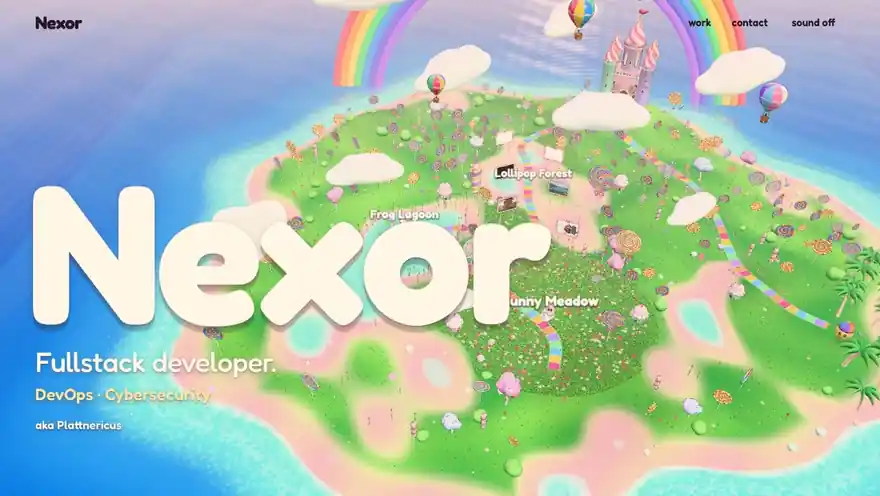
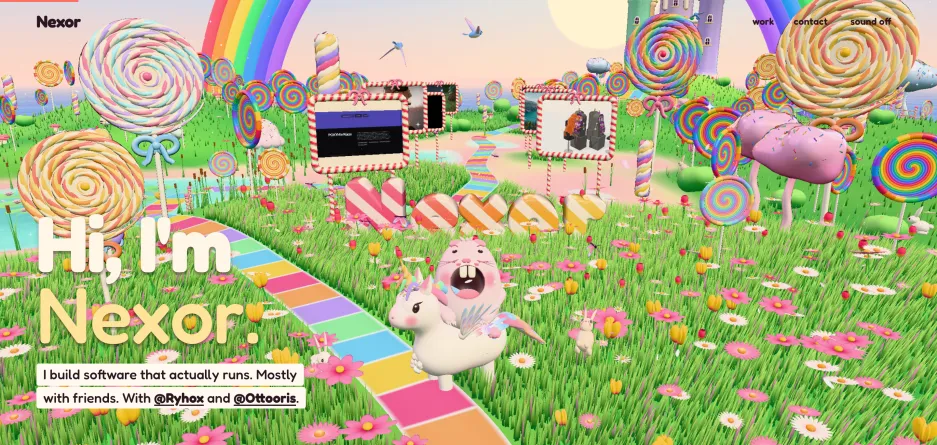
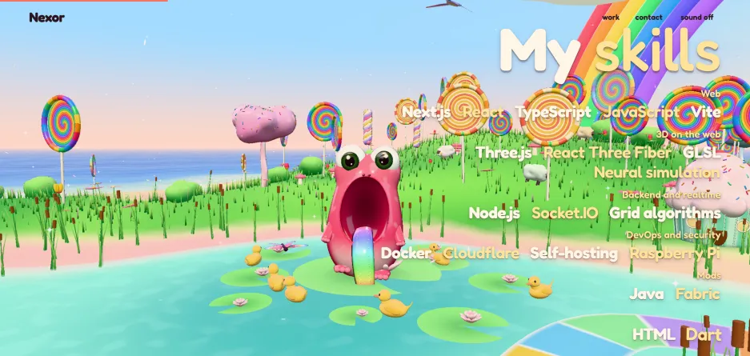
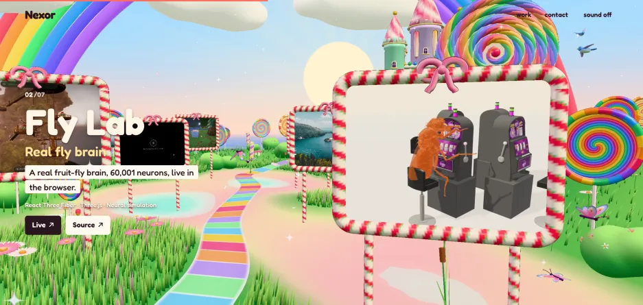
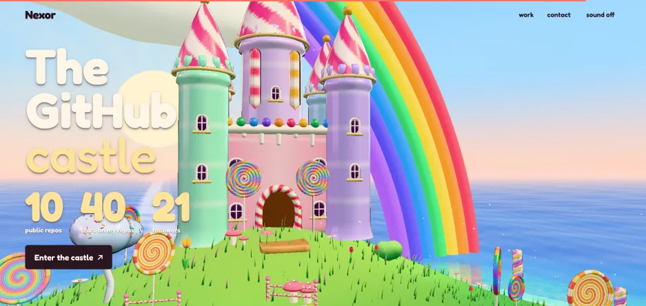
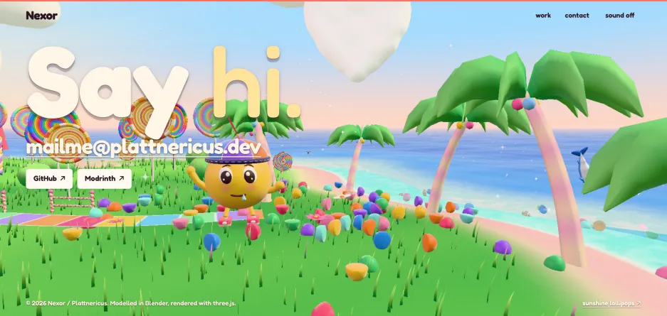
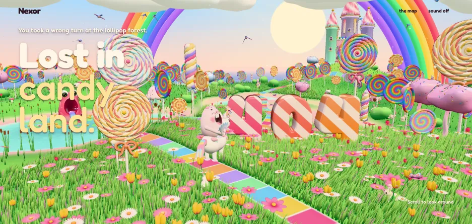
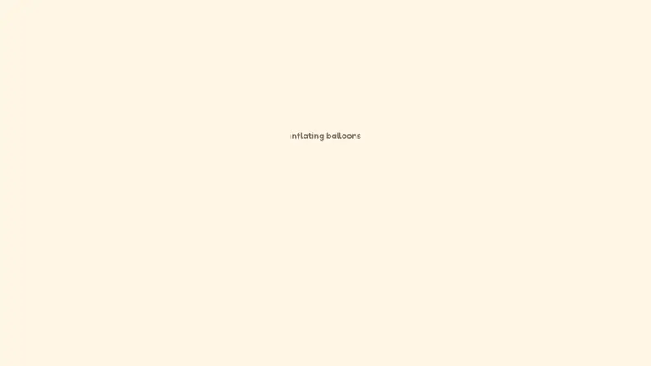
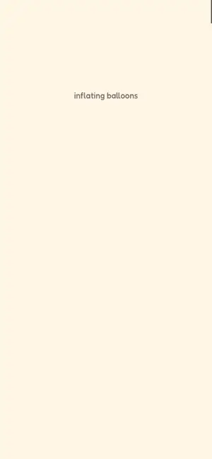

<div align="center">



<h1>Nexor / Plattnericus</h1>

<p><strong>A portfolio you scroll through like a map.</strong><br />
A candy island built in Blender, rendered live with three.js and flown through by the scroll wheel.</p>

<p>
  
  
  
  
  
  
</p>

<p>
  <a href="#the-island">The island</a> ·
  <a href="#loading-screen">Loading screen</a> ·
  <a href="#how-it-works">How it works</a> ·
  <a href="#performance">Performance</a> ·
  <a href="#getting-started">Getting started</a> ·
  <a href="#project-structure">Structure</a>
</p>

</div>

<br />

<table align="center">
  <tr>
    <td align="center" width="180"><h3>7</h3><sub>projects, each playing<br />a clip on its own sign</sub></td>
    <td align="center" width="180"><h3>100+</h3><sub>moves for every character,<br />picked by how you scroll</sub></td>
    <td align="center" width="180"><h3>3.8 MB</h3><sub>for the whole island,<br />meshopt + gzip</sub></td>
    <td align="center" width="180"><h3>120 fps</h3><sub>scrolling the whole page<br />on a 120 Hz display</sub></td>
  </tr>
</table>

<br />

## The island

The page is one long camera flight. Every section is a place on the map, and
the camera lands there as you scroll to it. Headlines, copy, counters and even
the wind follow the scroll position, so scrolling back plays everything in
reverse. Nothing hides behind a click.

<table>
  <tr>
    <td width="50%"></td>
    <td width="50%"></td>
  </tr>
  <tr>
    <td><sub><strong>Sunny Meadow.</strong> The wordmark drops out of the sky as rigid bodies and wobbles as it lands. The unicorn and the hamster show off, bunnies hop between the flowers, sheep graze, birds circle overhead.</sub></td>
    <td><sub><strong>Frog Lagoon.</strong> The skills, grouped in the content file, word by word as you scroll. GitHub languages that are not listed yet get a group of their own. Ducks paddle between the lily pads.</sub></td>
  </tr>
  <tr>
    <td></td>
    <td></td>
  </tr>
  <tr>
    <td><sub><strong>The trail.</strong> Every project plays a muted clip of itself on a candy sign, past cupcake cottages and candy-cane fences. Only the sign you are looking at plays.</sub></td>
    <td><sub><strong>The castle.</strong> Public repos, stars, followers, languages and the last push, read from the GitHub API and cached for an hour.</sub></td>
  </tr>
  <tr>
    <td></td>
    <td></td>
  </tr>
  <tr>
    <td><sub><strong>Dolphin Bay.</strong> Contact, palms and coral, fish under the water and dolphins further out. The smiley walks the sand in its sneakers, and a tap on the beach brings down a candy shower.</sub></td>
    <td><sub><strong>The 404.</strong> A short scroll around the letters, then the road back to the map.</sub></td>
  </tr>
</table>

The island answers the pointer too. Characters react when you click them, the
big lollipops in the meadow spin, and the letters of the wordmark wobble. Sound
is off until you switch it on in the header; it is a tiny WebAudio synth, so
there are no audio files to load.

A second route, [`/sunshine`](src/app/sunshine/page.tsx), keeps the original
"sunshine lollipops" meme ride through the same world.

## Loading screen

<p align="center">
  
  &nbsp;
  
</p>

Six layers of syrup rise with the download, each with its own wavelength,
speed and direction. A lollipop rides the swell between them, three layers
behind it and three in front, and its swirl fills up colour by colour. At 100 %
the syrup floods the screen from back to front, the lollipop shoots up and
bursts into sprinkles, and the flood drains away onto the map.

The waves are drawn on an `OffscreenCanvas` in a worker
([`src/components/syrup.ts`](src/components/syrup.ts)), so they keep moving
while the main thread parses models. Browsers without `OffscreenCanvas` draw
them on the page instead. Behind the syrup every shader is compiled and every
buffer uploaded, a slice per frame, so nothing is built later during the first
scroll. With reduced motion the syrup only ripples.

## How it works

### One scene, three routes

The home page, `/sunshine` and the 404 share one scene. A route only brings its
own camera keys and a few set pieces, all defined in
[`src/components/scene/layout.ts`](src/components/scene/layout.ts).

### Scroll and camera

Lenis smooths the wheel and drives GSAP's ScrollTrigger. Every section carries a
`[data-cam]` marker. On refresh the markers become anchors, and the camera
follows centripetal Catmull-Rom splines through the keys, reaching key *n*
exactly when marker *n* reaches the top of the viewport. Portrait screens get
their own framing for every key.

Text enters and leaves on scrubbed timelines
([`src/lib/reveal.ts`](src/lib/reveal.ts)), the GitHub numbers count with the
scroll, large headlines lean with scroll velocity, and a thin line at the top
tracks the trip. When the camera rises into map view, the place names grow out
of the ground one after another.

### Content

Copy, links, skills and projects live in
[`src/content/portfolio.json`](src/content/portfolio.json). Stars, languages and
push dates come from the GitHub API through a `"use cache"` function with
`cacheLife("hours")`. If GitHub cannot be reached, the page renders from the
content file alone.

### Shaders

| Piece | What it does |
| --- | --- |
| Sea | Two long swells in the vertices, finer waves summed per pixel so nothing aliases. A half-float terrain map gives depth and a pond mask: deep blue over open water, turquoise over the sand, calm clear teal in the ponds, surf on the beach |
| Island | Sea floor tinted per pixel from the terrain height, so the waterline stays smooth at any zoom |
| Grass | Up to 90,000 instanced blades in one draw call |
| Wind | One gust field for grass, flowers, bushes, palms, reeds and the forest. Gusts roll across the map as a front, fast scrolling adds a breeze |
| Cloud shadows | Soft shadows drifting over ground and lawn |
| Candy road | A ribbon along a spline, tiled in the fragment shader |
| Letters | Candy-cane stripes painted in object space over a physical material |
| Lollipop swirl | A rope spiral drawn per pixel on a flat disc, the light twin of the modelled lollipops |
| Character deformer | Squash, stretch, bend, twist and jelly around a character's feet, one set of uniforms for all its parts |
| Birds | Wing flap in the vertex shader, one draw call per flock |
| Petals and sparkles | Point sprites: tumbling blossom petals carried by the wind, four-point stars |
| Place names | One instanced draw of billboards cut from a canvas atlas |

### Characters

The unicorn and the hamster, the frog and the smiley each have more than a
hundred moves ([`src/components/scene/moves.ts`](src/components/scene/moves.ts)):
hops, flips, cartwheels, melts, jelly wobbles, dances and their own tricks. The
frog lassos with its tongue and dives through the lagoon, the unicorn rears and
gallops loops with the hamster cheering on its back, the smiley strolls the
beach and takes off on its propeller.

A performer plays them back to back. Scroll speed picks bigger moves and plays
them faster, a sharp change of direction startles everyone, arriving at a
character's section cues a show move, and recent moves are skipped so the whole
repertoire comes around. Arms, feet and ears are separate nodes in the models and
trail a little behind every jump and landing, so each character moves as one
soft body.

| Repertoire | Moves |
| --- | --- |
| Unicorn and hamster | 125 |
| Frog | 118 |
| Smiley | 114 |
| Dolphin jumps | 110 |
| Bunnies, sheep, ducks, birds | 87 to 88 each |

### Physics

Rapier loads in its own chunk. The island is a coarse static trimesh, gumdrops
and candy rain collide as boxes, and the letters keep their rotation locked so
the word stays readable; their wobble is a spring on the visible mesh. The world
is only stepped while a body is awake, so once everything has settled it costs
nothing.

### Offline and caching

Fonts, models and clips are served by the site itself, and nothing is loaded
from a CDN at runtime. Model URLs carry a content hash of the model files, computed in
[`next.config.ts`](next.config.ts), so browsers keep them for a year and a
changed model gets a new URL. Clips are sent with `must-revalidate`, so a new
deploy reaches everyone at once and unchanged files cost a 304.

### SEO

Canonical URLs, Open Graph and Twitter images, JSON-LD for the person, the site
and every project with its repository, `robots.txt`, `sitemap.xml` with project
images, a web manifest and a full icon set.

## Performance

The scene picks one of three tiers from pointer type, CPU cores, memory,
Save-Data and the GPU name. `?quality=low|mid|high` forces one.

| | High | Mid | Low |
| --- | --- | --- | --- |
| Triangles per frame | 2.1 to 3.0 M | 0.5 to 1.1 M | 0.28 to 0.43 M |
| Draw calls | 52 to 90 | 45 to 89 | 39 to 84 |
| Grass blades | 90,000 | 26,000 | 4,000 |
| Animals | 53 | 30 | 14 |
| Petals, pebbles, mushrooms, reeds | 420, 170, 60, 130 | 180, 90, 30, 70 | 0, 36, 12, 28 |
| Models | full up close, light twins far away | "Lo" twins | "Min" twins |
| Clearcoat, sheen, thin film | all three | clearcoat and sheen | none |
| Contact shadows | baked once | baked once | off |
| Project clips | all, after the intro | all, after the intro | only signs near the camera |
| DPR cap | 1.75 | 1.25 | 1.0 |

Triangles and draw calls are the range over 13 stops along the home page.
Distance twins (`far.glb`) are used on every tier; the phone twins (`lod.glb`)
are only downloaded on mid and low.

What keeps the scroll smooth:

- No shader is compiled and no buffer uploaded after the loader. Material
  quality is fixed before warm-up and never changes later.
- Wheel and touch moves never trigger a raycast. Hover is one raycast per frame
  at most, against simple hit spheres.
- Plants and the forest bend in the vertex shader, so their matrices are built
  once. Static props are baked into instanced crowds, culled as a group.
- In map view the characters' small parts drop out. At a few pixels tall they
  would still cost a draw call each.
- Text shadows are one sharp edge plus at most an 8 px blur, and the leaning
  headlines sit on their own compositor layer. Wide blurs on large type had to
  be rasterised again whenever it moved and stalled the GPU for 100 ms.
- Instanced and single meshes never share a material, so three.js does not
  switch programs between draws, and the per-frame code allocates next to
  nothing.
- A governor learns the refresh rate and checks the median frame of every half
  second. When frames run long it lowers the resolution first, then thins
  grass, flowers and sparkles.

Measured on the production build, scrolling the whole page. Phones are emulated
in Chrome with a slowed CPU; 6x is roughly a 2016 flagship such as a Galaxy S7
or iPhone 6s.

| Device | Tier | Result |
| --- | --- | --- |
| MacBook, 120 Hz display, Chrome | high | 120 fps both ways, 0 of 3118 frames over 12 ms, p99 9.3 ms |
| Desktop 1440 x 900 at 2x, headless | high | 60 fps (headless cap) |
| Phone 390 x 844 at 3x, CPU 4x slower | mid | 59 fps |
| Old phone 360 x 640 at 2x, CPU 6x slower | low | 58 fps, p95 16.8 ms |
| Very old phone 360 x 640 at 2x, CPU 10x slower | low | 47 to 52 fps |

From navigation to the map: about 2.3 s on desktop and 3.9 s on the emulated
old phone. Real phones have not been measured yet.

Touch devices keep native scrolling. `prefers-reduced-motion` turns off smooth
scrolling and softens every animation.

## Getting started

Requires Node 20.9 or newer.

```bash
npm install
npm run dev        # http://localhost:3000
```

```bash
npm run build && npm start
npm run lint
```

## Configuration

Everything is optional. Put what you need into `.env.local`.

| Variable | Default | Purpose |
| --- | --- | --- |
| `NEXT_PUBLIC_SITE_URL` | `site.url` in the content file | Canonical URL, Open Graph, sitemap |
| `GITHUB_USER` | `github.user` in the content file | Whose profile and repositories to read |
| `GITHUB_TOKEN` | none | Raises the GitHub API rate limit |

To change the projects, edit `projects` in
[`src/content/portfolio.json`](src/content/portfolio.json) and put a poster and a
clip into `public/work/`. The first seven projects get a sign on the trail.

## Project structure

```
src/
  app/                    routes, metadata, icons, OG images, robots, sitemap, manifest
  content/portfolio.json  everything the page says
  lib/                    GitHub data, scroll, sound, quality tiers, shared state
  components/
    Loader.tsx, syrup.ts  loading screen and its wave worker
    Experience.tsx        Lenis, ScrollTrigger and section state for every route
    home/                 portfolio sections
    sunshine/             the meme route
    lost/                 the 404
    scene/                terrain, sea, sky, props, characters, physics, camera
  fonts/                  Fredoka, self-hosted (SIL OFL 1.1)
public/
  models/                 meshopt-compressed GLB sets, far.glb (distance twins),
                          lod.glb (phone twins)
  work/                   project clips, plus posters for search and link previews
```

## Credits

Typeface: [Fredoka](https://github.com/hafontia/Fredoka-One) by The Fredoka
Project Authors, under the SIL Open Font License 1.1 (licence text in
[`src/fonts`](src/fonts)). The 3D wordmark is cut from its bold instance.
Physics by [Rapier](https://rapier.rs). All 3D models were built in Blender for
this project.
